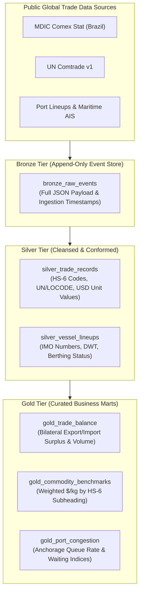

# 🌐 OpenComex Lakehouse Intelligence

[](LICENSE)
[](https://www.python.org/)
[-green)](https://www.databricks.com/glossary/medallion-architecture)

Open-source international trade intelligence and multimodal supply chain lakehouse designed to aggregate, cleanse, and model global trade flow data (MDIC Comex Stat, UN Comtrade, Eurostat, and AIS maritime tracking).

---

## 🏗 Medallion Lakehouse Architecture



---

## 📐 Data Modeling & Analytical KPIs

### 1. Bilateral Trade Balance Formulation

$$\text{Trade Balance}_{\text{rep, part, } t} = \sum \text{FOB}_{\text{export}} - \sum \text{FOB}_{\text{import}}$$

### 2. Weighted Commodity Unit Price ($/kg)

$$\bar{P}_{HS6} = \frac{\sum_{i=1}^N \text{FOB USD}_i}{\sum_{i=1}^N \text{Net Weight (kg)}_i}$$

### 3. Port Congestion Index

$$\text{Congestion Rate (\%)} = \left( \frac{\text{Vessels in Anchorage Waiting}}{\text{Total Vessels in Lineup}} \right) \times 100$$

---

## 🚀 Quick Start

### Installation

```bash
# Clone the repository
git clone https://github.com/Wenderson-Werneck/opencomex-lakehouse-intelligence.git
cd opencomex-lakehouse-intelligence

# Install dependencies
pip install -r requirements.txt
```

### Running Automated Test Suite

```bash
pytest -v
```

### Example Usage

```python
from src.lakehouse import ComexLakehouseEngine
from src.models import TradeRecord

engine = ComexLakehouseEngine()

records = [
    TradeRecord(
        transaction_id="TX_202611_001",
        flow_direction="EXPORT",
        reporter_country="BRA",
        partner_country="EST",
        hs6_code="720211",
        hs6_description="Ferro-manganese",
        net_weight_kg=500_000,
        fob_usd=650_000.0,
        port_unlocode="BRSSZ",
        period_year_month="2026-11",
    )
]

# Ingest through Bronze into Silver
engine.ingest_trade_bronze_to_silver(records)

# Build Gold Marts
df_balance = engine.build_gold_trade_balance()
print(df_balance)
```

---

## 🔒 Security & Open Standards

- 100% synthetic demonstration data and open government datasets.
- Schema compliant with UN/LOCODE, ISO 3166-1 alpha-3, and DCSA track & trace specifications.

## 📄 License

MIT © [Wenderson Werneck](https://github.com/Wenderson-Werneck)
